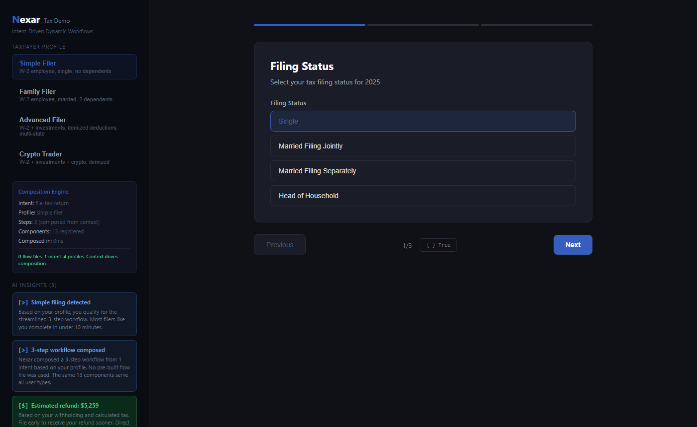

# Nexar

**Intent-Driven UI Framework**

Nexar is the AI layer between business intent and rendered UI. Instead of writing screens, you define what the user needs to accomplish. The engine composes the right UI from a validated component registry, adapting to user context, device, and business rules at runtime.

**Live demo:** [nexar.al-ex.ai](https://nexar.al-ex.ai)



## The Problem

Modern apps manage hundreds or thousands of screen definitions. Each user segment, each platform, each A/B test variant is a separate artifact someone has to create, test, and maintain. Server-Driven UI (SDUI) moved the definitions from client to server, but didn't reduce the number of definitions. The maintenance scales linearly with the number of user types.

## The Solution

Nexar replaces pre-built screen definitions with **intents** and **composition rules**. One intent can produce thousands of unique flows based on context. No screen files. No routing table. The flow emerges from the user's context at runtime.

```
Traditional:  60,000 flow files → Router picks one → Renderer displays it
Nexar:        1 intent + context → Engine composes → Renderer displays it
```

## Architecture

```
┌─────────────────────────────────────────────┐
│              Developer Layer                 │
│  Component Registry │ Intent Definitions     │
│  Design Tokens      │ Composition Rules      │
└────────────────────────┬────────────────────┘
                         ↓
┌─────────────────────────────────────────────┐
│              Composition Engine              │
│                                             │
│  Rules Strategy (deterministic)             │
│  AI Strategy (LLM-powered, pluggable)       │
│  RAG Engine (knowledge-augmented)           │
│  Validation Pipeline (constraints, a11y)    │
└────────────────────────┬────────────────────┘
                         ↓
┌─────────────────────────────────────────────┐
│              Runtime Layer                   │
│  State Store │ Action Executor │ Event Bus  │
│  Expression Engine │ Conditional Rendering  │
└────────────────────────┬────────────────────┘
                         ↓
┌─────────────────────────────────────────────┐
│              Renderer Layer                  │
│  React (web) │ React Native │ SwiftUI │ ... │
└─────────────────────────────────────────────┘
```

## Packages

| Package | Description |
|---------|-------------|
| `@nexar/core` | Intent schema, types, component registry, design tokens |
| `@nexar/engine` | Composition engine, rules strategy, validation, actions, expressions |
| `@nexar/ai` | Model adapter (Gemini, OpenAI, Azure, Anthropic, Ollama), RAG engine, AI composition |
| `@nexar/react` | React renderer, provider, hooks |
| `@nexar/state` | Observable state store with subscriptions |
| `@nexar/analytics` | Render and interaction tracking |
| `@nexar/cli` | Scaffold, test, deploy intents |
| `@nexar/devtools` | Browser extension for debugging |

## How It Works

### 1. Register Components

Components are the building blocks. Each declares its constraints, accessibility requirements, and platform support.

```typescript
engine.registry.register({
  type: 'ssn-input',
  category: 'input',
  description: 'Social Security Number input with masking',
  constraints: {
    a11y: { requiresLabel: true },
  },
  platforms: { web: { supported: true }, mobile: { supported: true } },
});
```

### 2. Define Intents

An intent describes what the user needs to accomplish, not what the screen looks like.

```typescript
const intent: Intent = {
  id: 'onboard-user',
  label: 'User Onboarding',
  description: 'Collect user information and set up account',
  requires: ['name', 'email', 'password'],
};
```

### 3. Write Composition Rules

Rules map intents to component trees based on context. The same intent produces different UI for different users.

```typescript
strategy.addRule('onboard-user', (intent, context) => {
  const steps = [
    { type: 'input', id: 'name', props: { label: 'Full Name', bind: '$form.name' } },
    { type: 'input', id: 'email', props: { label: 'Email', bind: '$form.email' } },
  ];

  // Premium users get additional options
  if (context.data?.tier === 'premium') {
    steps.push(
      { type: 'input', id: 'company', props: { label: 'Company', bind: '$form.company' } },
    );
  }

  return { type: 'wizard', id: 'onboard', props: {}, children: steps };
});
```

### 4. Render

The renderer maps the composed tree to platform-specific components. The tree is platform-agnostic.

```tsx
<NexarRenderer
  tree={composedTree}
  components={componentMap}
  state={stateSnapshot}
  onAction={handleAction}
  onStateChange={handleStateChange}
/>
```

## Key Concepts

| Concept | Description |
|---------|-------------|
| **Intent** | What the user needs to accomplish. Not a screen. |
| **Context** | User profile, platform, business data. Drives composition. |
| **Component Registry** | All available building blocks with constraints. AI and rules can only use registered components. |
| **NexarTree** | Platform-agnostic component tree. Output of composition. Input to rendering. |
| **Composition Strategy** | Pluggable: rules (deterministic), AI (LLM-powered), or hybrid. |
| **State Binding** | `$form.email` in props resolves from state store. Two-way binding on inputs. |
| **Conditional Rendering** | `when: "$user.isPremium"` shows/hides nodes based on state. |
| **Actions** | setState, API calls, validation, navigation. Declarative, executed by ActionExecutor. |
| **Plugins** | Teams ship components + intents as plugins. Shared registry, independent deployment. |

## Demos

### Example App (`apps/example`)

Basic demo with 4 intents (dashboard, login, profile, contact) showing state binding, conditional rendering, and live state inspector.

```bash
cd apps/example && pnpm dev  # http://127.0.0.1:4100
```

### Tax Demo (`apps/tax-demo`): [Live Demo](https://nexar.al-ex.ai)

Dynamic tax workflow engine demonstrating context-driven composition. One intent produces 3-6 step wizards based on user profile. Includes tax computation engine and AI insights.

```bash
cd apps/tax-demo && pnpm dev  # http://127.0.0.1:4200
```

See [apps/tax-demo/README.md](apps/tax-demo/README.md) for details.

## Quick Start

```bash
# Prerequisites: Node 22+, pnpm 9+
pnpm install
pnpm build
pnpm test

# Run a demo
cd apps/tax-demo && pnpm dev
```

## Tech Stack

| Tool | Purpose |
|------|---------|
| TypeScript 5.9 | Strict mode, zero `any` |
| Turborepo | Monorepo build orchestration |
| pnpm | Package management |
| Biome | Linting and formatting |
| Vitest | Testing |
| React 19 | Default renderer |
| Vite 7 | Dev server and bundling |

## License

Apache 2.0. See [LICENSE](LICENSE).

## Author

Alex Husniddinov
